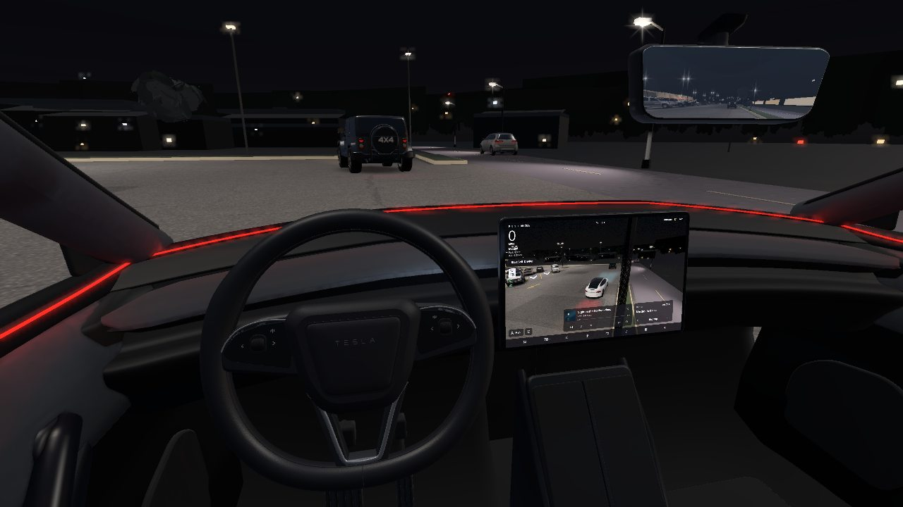
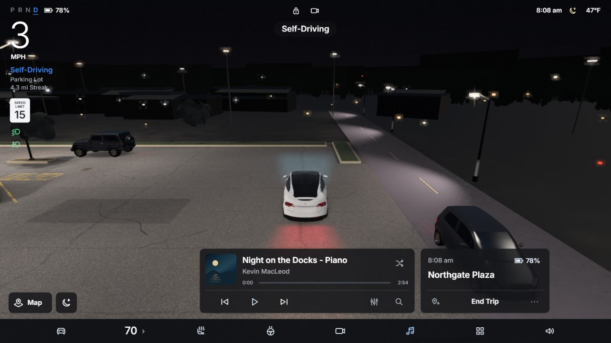
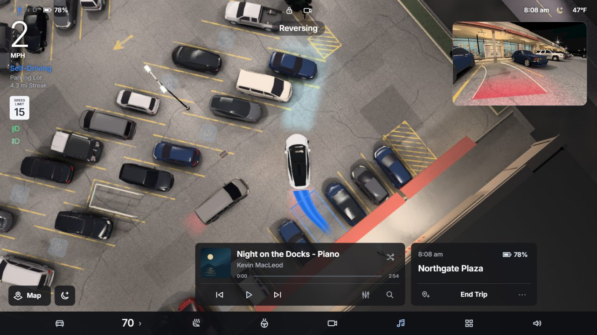
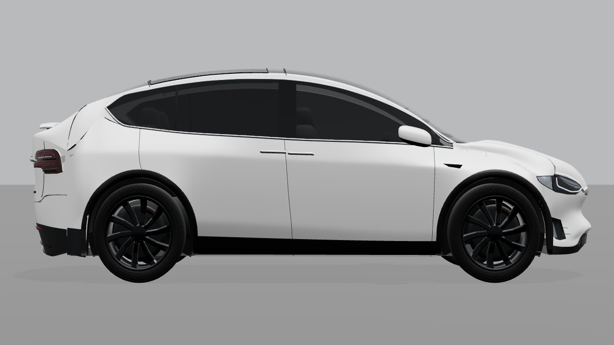

# Tesla Reality View demo

Sit in a Model X at night and start a self-driving trip from San Francisco's Chestnut Street to the Palace of Fine Arts. The mouse wheel takes you from the driver's seat into Reality View, where you can choose a free bay and watch the car back into it. The original Northgate parking lot is also playable.

**Unofficial fan project. Not affiliated with or endorsed by Tesla, Inc. Tesla and Model X are trademarks of Tesla, Inc.**

| Model X cabin | Reality View chase |
| --- | --- |
|  |  |
| **Straight-down parking** | **Model X studio** |
|  |  |

## Run locally

Use Node.js 24 or later and a WebGL 2 browser.

```sh
npm ci
npm run dev
```

For the production build, run `npm run build` and `npm run preview`. Open the URL Vite prints.

## Controls

| Input | Action |
| --- | --- |
| Start Self-Driving | Dive into Reality View and start the drive. |
| Click a free bay or its marker | Choose a space and back in. Cancel Selection is available until the car begins reversing. |
| Mouse wheel | Move between the seat and the screen. |
| `1` or `Esc`, `2` | Go to the seat or the screen, respectively. Double-click the tablet to dive in. |
| Drag Reality View | Orbit and tilt. Double-click empty road to recenter. |
| Move the mouse in the seat | Look around. The gaze holds over the tablet. |
| `W A S D` or arrow keys | Take over driving. Press Start Self-Driving to rejoin the San Francisco route. In Northgate, release the keys to let the car settle or resume self-driving after two seconds. |
| End Trip | Stop and shift to Park. |
| `F2` or backtick | Show renderer, performance, Scene and World controls. |
| Music card | Play, pause or change tracks. Sound is available after the first click. |

| URL switch | Action |
| --- | --- |
| `?scene=sf` or `?scene=lot` | Choose San Francisco (default) or Northgate. |
| `?q=high` or `?q=low` | Force the quality tier. |
| `?view=seat` or `?view=screen` | Pick the initial viewpoint. |
| `?bot=1` | Run the parking demo automatically. |
| `?bay=B058` | Request a target bay for the parking bot. |
| `?world=mesh` or `?world=splat` | Choose Northgate's mesh or Gaussian splat world. |
| `?world=splat&cars=mesh` | Use splats for Northgate scenery and meshes for cars. |
| `?studio=side` | Open the Model X studio. |

## Technology and assets

The browser renderer uses [three.js](https://threejs.org/) and [Spark](https://sparkjs.dev/). The asset scripts run headless in Blender 5.2. The repository includes the generated runtime assets. Reference images are kept locally outside the repository. Authoring and comparison scripts accept `TESLA_REF_DIR` and default to `../ref`.

San Francisco road and building data is © OpenStreetMap contributors (ODbL). See [map sources and route audit](data/osm/README.md).

See [CREDITS.md](CREDITS.md) for asset licences and [REPORT.md](REPORT.md) for development and verification notes.
